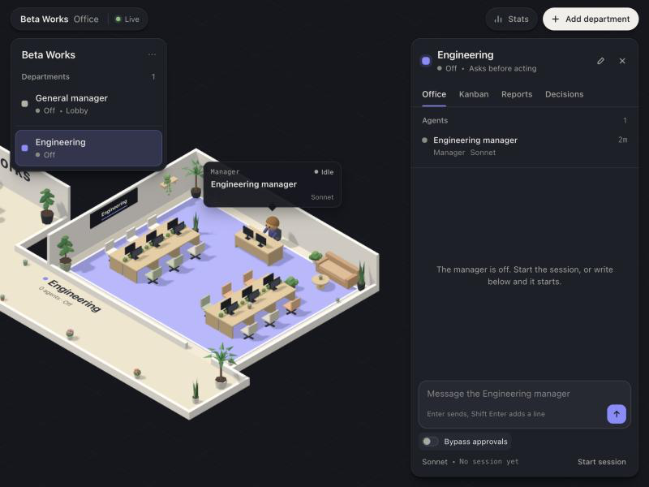
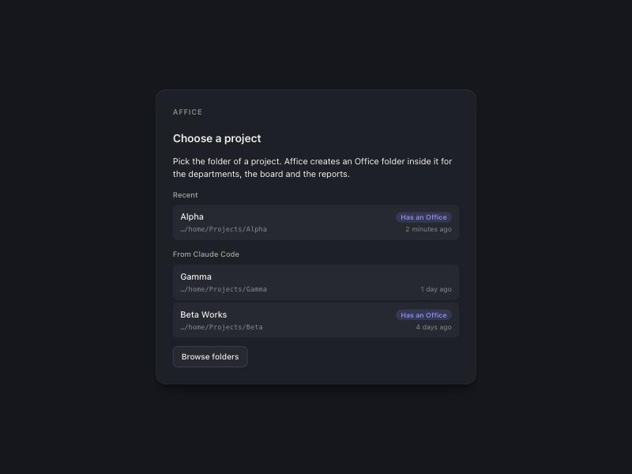
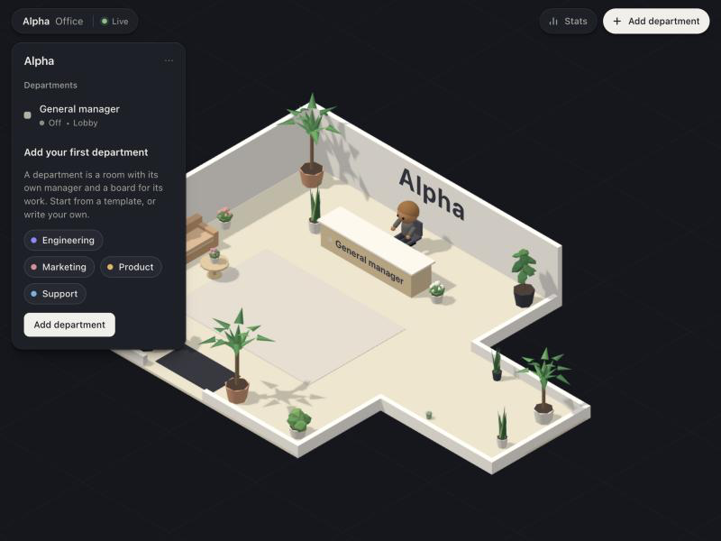
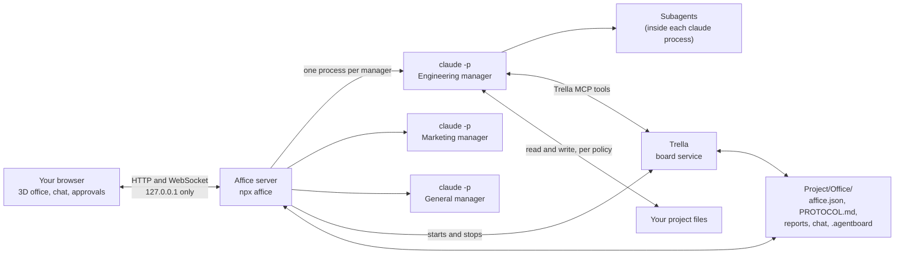
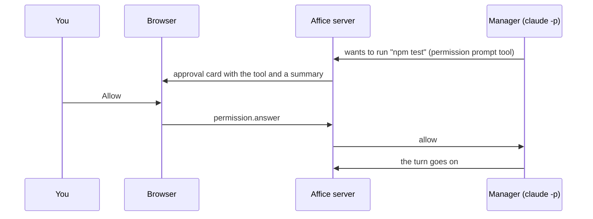

# Affice

**A virtual office for your Claude Code agents.**

[](https://github.com/thePlane-ai/Affice/actions/workflows/ci.yml)
[](https://www.npmjs.com/package/affice)
[](LICENSE)

Affice is a local web app that turns one of your projects into an office. Each department is a room with a manager, and the manager is a real Claude Code session running on your own sign-in. The manager's subagents sit at desks, a [Trella](vendor/trella) board holds the work, and you watch and steer all of it from your browser. Nothing is hosted: it runs on your machine, and nothing leaves it except what Claude Code itself sends.

<p align="center">
  
</p>

- [Install it with your Claude](#install-it-with-your-claude)
- [Quick start by hand](#quick-start-by-hand)
- [What you get](#what-you-get)
- [How it works](#how-it-works)
- [Using it](#using-it)
- [Configuration](#configuration)
- [Safety and privacy](#safety-and-privacy)
- [Troubleshooting](#troubleshooting)
- [Run it from a clone](#run-it-from-a-clone), [Contributing](#contributing), [License](#license), [Notice](#notice)

## Install it with your Claude

The easiest way: open Claude Code in any folder, paste the prompt below, and let it do the rest. Claude reads [INSTALL.md](INSTALL.md), checks your machine with `npx affice doctor --json`, fixes what is missing, starts Affice and tells you where to open it.

It will not sign in for you, it will not use `sudo`, and it asks before installing anything globally. If something needs a decision from you, it stops and asks.

```text
Install and start Affice for me. Affice is a local web app that runs my own Claude Code as manager agents, one room per department.

1. Read the install guide at https://raw.githubusercontent.com/thePlane-ai/Affice/main/INSTALL.md (fetch it with curl or your web fetch tool) and follow it exactly.
2. Run `npx affice doctor --json`. If "ok" is false, fix every failed check by following that check's "fix" text, then run the doctor again until it passes. Ask me before anything that needs my decision.
3. Start Affice with `npx affice`. If no browser can be opened from here, use `npx affice --no-open` instead and keep it running in the background.
4. Tell me the address to open (http://localhost:4747 unless Affice printed another one) and what to do first.

Rules: never sign in for me (if Claude Code is signed out, tell me to run `claude auth login` or to use the Sign in button in Affice), do not use sudo, do not install anything globally without asking me, do not edit any of my projects, and do not read or print any credentials.
```

Prefer to do it yourself? Read on.

## Quick start by hand

You need:

- **Node.js 22.5 or newer** (`node --version`). Trella needs `node:sqlite`, which arrived in 22.5.
- **Claude Code**, installed and signed in with a **Claude subscription** (Pro, Max, Team or Enterprise). Version 2.1.211 or newer is best; an older one still runs, without the subagent text in the speech bubbles. Install and sign-in steps are in the [Claude Code docs](https://code.claude.com/docs/en/setup).
- macOS or Linux. Windows works only through WSL, and that is untested.

Then run:

```sh
npx affice
```

What happens the first time:

1. Affice starts on `127.0.0.1:4747` and opens `http://localhost:4747` in your browser.
2. If Claude Code is missing or signed out, a setup screen shows the exact command to run, or a **Sign in with Claude** button that starts Claude Code's own browser sign-in. Affice never sees your password.
3. You pick a project: your recent Affice projects, the projects Claude Code already knows, or any folder through the folder browser. Affice creates an `Office/` folder inside it.
4. The lobby opens, with the general manager at the reception desk. Add your first department, from a template or with your own text, and talk to its manager.

<p align="center">
  
</p>

`npx affice doctor` checks your setup without starting anything. `npx affice --project ~/code/my-app` skips the picker. The default address is `http://localhost:4747`; see [Configuration](#configuration) for the rest.

## What you get

- **A room per department.** Each department has its own room in a 3D office, its own manager and its own board. You write what the department is responsible for, and that text becomes the manager's instructions.
- **A manager chat per room.** Each manager is a real Claude Code session on your own sign-in (`claude -p`, driven over stream-json). You chat with it beside the room. It streams its answer, shows the tool it is using, and can be interrupted.
- **Subagents at desks.** When a manager delegates work, each subagent shows up as an avatar and walks to a desk, with a speech bubble that shows what it is doing. When it finishes, it waves and leaves.
- **The general manager in the lobby.** It sits at the reception desk, answers general questions about the project, and asks the department managers instead of doing their work. Department managers can ask each other too, through `ask_manager`.
- **A Trella board per department.** Every piece of work is a card. The managers read and write the board through Trella's MCP tools, and you see the same board in the Kanban tab.
- **Data views for every room.** Kanban (the board), Branches (a map of the department's git branches: in flight, merged, stale), Reports (what the agents wrote) and Decisions (cards that wait for your choice).
- **Approvals in your browser.** When a manager wants to run a command, edit a file, use the web or read outside the project, a card in the chat shows the tool, the folder and the whole command or edit. You allow or deny it.
- **A Bypass approvals switch** in every chat, for when you trust a session to run without asking. It is per session, it asks first, and it is off whenever a session starts.
- **One command to start.** `npx affice` serves the page, the API and the socket on one port, and starts and stops Trella for you.

<p align="center">
  
</p>

## How it works



- **One server.** `npx affice` runs a single Node process on `127.0.0.1:4747`. It serves the built page, the JSON API and the WebSocket at `/ws`. The browser shows the office and sends your commands; the server keeps the state.
- **One `claude` process per manager.** The server starts your own, unmodified `claude` in the department's working directory, with the manager's instructions appended to its system prompt, and talks to it over stdin and stdout (`--input-format stream-json --output-format stream-json`). A session starts when you press Start or send the first message, and it resumes the earlier conversation when it can.
- **Subagents live inside their manager's process.** Affice reads the events Claude Code emits and draws each subagent as an avatar.
- **Trella is the board.** When a project opens, Affice starts a Trella service for `<project>/Office` on a free local port and stops it again when the project closes. Each manager gets Trella's MCP server, with its own identity (`agent:<department>-manager`), so every change on the board says who made it.
- **Approvals go through a tiny MCP server.** In the `ask` and `accept-edits` policies, Claude Code asks the office MCP server for permission before a write, a command, a web request or a read outside the project. The server turns that into a card in your browser and waits for your answer.



### What is written where

Everything Affice writes for itself stays in the project's `Office/` folder, plus one small file in your home folder.

```text
<your project>/
  Office/
    affice.json      the office: its name, the departments, models, policies, session ids
    PROTOCOL.md      how agents work here; written once, yours to edit
    .agentboard/     Trella's workspace: boards and cards as plain JSON
    reports/         what the agents write
    chat/            the chat history, one file per department (git-ignored)
    .gitignore       keeps chat/ out of git
~/.affice/
  projects.json      the recent projects (AFFICE_HOME moves this folder)
```

The managers work in your project (the department's working directory, the project folder by default). What they may do there is the department's permission policy: ask for everything, accept edits, or read only. Claude Code keeps its own session transcripts where it always does, in its own folder.

### The protocol every manager gets

`Office/PROTOCOL.md` is written once, the first time a project opens, and never overwritten, so your edits stay. Its text is also appended to every manager's system prompt at each start, so the protocol works without a `CLAUDE.md` of your own. The default says:

- **The office:** you own the project and make the decisions; the general manager answers and asks, the department managers plan, delegate and report.
- **Cards:** every piece of work is a card. Claim it, move it to the working column, comment when something surprising happens, write the report, and move it to Review. The card key (for example `ENG-12`) travels with the work: the branch is `task/ENG-12-short-slug`, the commit ends with a `Card: ENG-12` line, and the subagent's description starts with the key.
- **Reports:** what was done, what was verified and what was not, in `Office/reports/YYYY-MM-DD-<KEY>-<topic>.md`.
- **Decisions:** when you must choose, the card gets the label `decision`, with the question, the options and a recommendation.
- **Working in the project:** stay inside it, no destructive git commands, commit only when asked, and wait for an approval instead of working around a refusal.
- **Working with other managers:** ask with `ask_manager`, say who you are, ask for information or a result and not for your job to be done.
- **Honesty:** say what failed and what you did not verify; never invent progress.

The branch and card conventions are defaults, not rules of Affice. Edit `PROTOCOL.md` to fit how you work. The full design is in [docs/ARCHITECTURE.md](docs/ARCHITECTURE.md).

## Using it

**Add a department.** Press **Add department** (top right), or pick a template in the empty lobby: Engineering, Marketing, Product or Support. Give it a name and a color, then write its **responsibility**: a few sentences on what the department owns and delivers and when it should ask you. That text becomes the manager's instructions. You can also set the working directory (the project folder by default), the model (`opus`, `sonnet`, `haiku`, or a full model id), the permission policy, the git repositories for the Branches view (a relative path starts at the project folder, so `.` is the project itself, and a folder inside a repository is read as that repository), the folders for reports (`reports` in the Office folder by default, where the managers write them), and extra folders the manager should read. Creating the department also creates its board.

**Talk to a manager.** Click a room, or its name in the list. The chat opens beside the office. Enter sends, Shift+Enter adds a line. The session starts with your first message (or with **Start session**). While it works you see its tools, the subagents arriving at desks, and its answer as it streams. **Interrupt** ends the running turn and keeps the session.

**Approvals.** With the **Ask** policy, every tool that needs permission waits for you as a card in the chat: the tool, who asked, the folder the manager works in, the file the call touches and the whole command or edit in a monospace block. A long block starts at a few lines, scrolls, and has **Show all**. Text over 8,192 characters is cut, and the card says how much was cut. **Allow** or **Deny**. **Accept edits** lets file edits through and asks for the rest. **Read only** runs nothing that changes anything.

What runs without a card (policies Ask and Accept edits): reading files inside the project folder (the Office folder included) and inside the department's knowledge folders, subagents, Trella's board tools (`mcp__trella__*`), the todo list, and the office tools. What always asks: writes and edits (except in Accept edits), shell commands, web access (`WebFetch` and `WebSearch`), reading files outside the project and the knowledge folders, and asking a manager that accepts edits. In **Read only** the same things run without a card, except the todo list. It has no way to ask, so everything else is refused: it cannot browse the web, cannot read outside the project, and cannot write or run a command. **Bypass** (below) turns all of this off for a session.

**Bypass.** The **Bypass approvals** switch in the chat footer restarts that manager's session, with the same conversation, with every permission check skipped. The first time in a session it asks you to confirm what that means. While it is on, a red line shows at the top of the chat, the room header says "Approvals off" in red, and a red mark shows in the lobby list. Turning it on is refused while a turn is running (wait or interrupt first). It is never saved: a stop, a crash or a restart of Affice turns it off. Use it only on a project where you accept that the manager can run any command and edit any file.

**The general manager and `ask_manager`.** The general manager is the first entry in the lobby list. Ask it where things stand, and it asks the right department and brings the answer back. Every manager can use the office tools `list_departments`, `office_status` and `ask_manager`. A question shows in the target's chat, labelled with who asked. A chain of questions is at most two managers deep, a manager that is itself waiting for an answer cannot be asked, and a manager running in bypass takes no questions from other agents. A question to a manager that accepts edits waits for you first: a card in the asking manager's chat shows who asks whom and the whole message (at most 8,192 characters), and if you deny it the asking manager gets a refusal and nothing is sent. Questions to Ask and Read only managers need no card, because what those managers do still goes through their own rules.

**Switch projects.** Click the project name in the lobby panel: recent projects, **Open another project**, **Close project**. Switching stops the open project's sessions and its Trella service, then opens the other project with its own office. Every project keeps its own `Office/` folder, so each office is exactly as you left it.

## Configuration

Settings come from environment variables and three command line options. Everything has a default; most people set none of them.

| Variable or option | Default | What it does |
| --- | --- | --- |
| `AFFICE_PORT`, `--port <n>` | `4747` | The port of the office. Affice always listens on `127.0.0.1` only. |
| `AFFICE_PROJECT`, `--project <path>` | none | A project to open at start. Without it, the browser shows the project picker. |
| `--no-open` | off | Do not open the browser. |
| `AFFICE_HOME` | `~/.affice` | Where Affice keeps the list of recent projects (`projects.json`). |
| `CLAUDE_BIN` | found automatically | The `claude` binary to run. Normally Affice looks on `PATH`, then in `~/.local/bin`, `/opt/homebrew/bin`, `/usr/local/bin`, `~/.claude/local` and the npm global folder. A wrong `CLAUDE_BIN` is an error, never a silent fallback. |
| `AFFICE_TRELLA_PORT` | `4174` | The first port Trella's service tries. If it is taken, the next free port is used. |
| `AFFICE_TRELLA_CLI` | the bundled Trella | Path of a Trella CLI to run instead (for development). |
| `CLAUDE_CONFIG_DIR` | `~/.claude` | Claude Code's own configuration folder. Affice reads its project list from there (read only) and passes the variable on to the managers. |
| `AFFICE_CLAUDE_JSON` | `~/.claude.json` | Moves only the file the project picker reads Claude Code's project list from. Read only. |
| `AFFICE_CLIENT_DIR` | the built page in the package | A different built client to serve (for development). |

Commands: `affice [start]`, `affice doctor [--json] [--port <n>]`, `affice init <path>` (creates a project's `Office/` folder without starting the server), `affice --version` and `affice --help`.

Affice sets a few variables for its own parts and you should not set them: `AFFICE_OPEN_BROWSER` (the launcher), `AFFICE_URL`, `AFFICE_DEPARTMENT` and `AFFICE_AGENT_TOKEN` (the office tools of a manager), and `TRELLA_PROJECT` and `TRELLA_ACTOR` (the Trella tools of a manager).

**Which sign-in the managers use.** Affice needs one thing from Claude Code: a sign-in with a Claude subscription. It removes every `CLAUDE_*` (except `CLAUDE_CONFIG_DIR`), `ANTHROPIC_*` and `MCP_*` variable from the environment of the managers, so a stray variable in your shell, or the session you started Affice from, can never change how they sign in. Your sign-in is what they use, and your own Claude Code settings files still apply.

## Safety and privacy

**Local only.** The server binds `127.0.0.1`. It answers a request only when the `Host` header is exactly `localhost:<port>` or `127.0.0.1:<port>`, a browser's `Origin` is exactly the same origin (scheme, host and port, so a page on another local port is refused), and the browser does not say the request is cross-site. On top of that every route and the WebSocket need a token that the Affice page gets when it loads, and each manager's office tools get a token of their own that opens only their own few routes. Anything else gets a 403 or a 401. That stops other websites and other localhost ports from driving your managers, and it stops DNS rebinding. It does not stop a program on your own computer: see [Known limitations in this beta](SECURITY.md#known-limitations-in-this-beta). Trella's service listens on `127.0.0.1` only, and Affice checks that it does. The file browser in the picker lists folder names and never a file or its contents, and the report viewer serves only files inside a department's report folders (HTML reports run in a sandbox with no network, which cannot reach the office). Affice never writes through a symbolic link, repairs a hand edited or hostile `Office/affice.json` when it loads it, and keeps your chat history and project list readable by you alone.

**Nothing leaves your machine except what Claude Code sends.** Affice has no telemetry and no analytics, and its own server and page make no requests except to your own machine. What your managers read, write and say goes to Anthropic the way it does whenever you use Claude Code, under the settings you chose there.

**Your credentials stay yours.** Affice never reads, stores or asks for your credentials. It runs your own, unmodified `claude`, signed in the way Claude Code signs in. The **Sign in with Claude** button only starts `claude auth login` for you; the sign-in itself happens in your browser, with Anthropic. Affice only asks Claude Code whether you are signed in and by which method. It never reads your email, your organization or any token.

**Approvals are on by default.** A new department asks before it acts. Bypass is per session, it asks you to confirm the first time, it is never saved, and it is off every time a session starts. Departments can be set to Read only, which runs nothing that changes anything.

**What runs without asking, and what always asks.** Without a card: reads inside the project folder and the department's knowledge folders, subagents, and Trella's board tools. Always a card: writes (except in Accept edits), shell commands, web access, reads outside the project, and a question to a manager that accepts edits. A Read only manager cannot browse the web at all. The point is that a manager which reads a hostile file, web page or board card cannot be talked into reading some other file on your machine and sending it out: sending needs the web or a command, and both ask. Read the card before you press Allow, because the text a manager reads can contain instructions, and the card shows what it would really do. Claude Code's own rules and your own Claude Code settings still apply underneath: an allow rule you wrote there lets a manager do that without a card, and Claude Code decides which shell commands count as read only. Bypass turns all of the above off for that session: no cards, every file, the web and the shell.

**Only open projects you trust.** The managers run `claude -p`, Claude Code's non-interactive mode. It does not show the folder trust dialog, so the hooks in a project's Claude Code settings and the servers in its `.mcp.json` run as soon as a manager starts, the same as in any `claude -p` run. A project from a stranger can carry hooks and MCP servers you did not read, and an `Office` folder that points Affice's helpers at things you did not choose. Treat a repository from a stranger like code you are about to run: open it in Claude Code yourself first, read its hooks, its `.mcp.json` and its `Office` folder, and only then open it in Affice. This beta has known limitations, written down plainly in [SECURITY.md](SECURITY.md#known-limitations-in-this-beta).

**Many managers use your plan up faster.** Every manager is its own Claude Code session, and subagents are more sessions inside them. Several managers working at once use your plan's limits faster than one session does. Watch your usage, and give the cheaper models (`haiku`, `sonnet`) to departments that do not need `opus`.

**How this relates to Anthropic's terms.** Affice starts your own, unmodified `claude` command on your own computer, signed in the way Claude Code itself signs in, and it never sees a credential. It does not offer a Claude login of its own, and it does not route anyone else's requests through your account. Anthropic's terms for Claude Code, and for tools built around it, are Anthropic's to set and can change. Read them, in particular [legal and compliance](https://code.claude.com/docs/en/legal-and-compliance), and decide whether this use fits your plan. This is not legal advice. Affice is an independent open-source project: it is not made, endorsed or supported by Anthropic, and Claude and Claude Code are Anthropic's names.

How Affice is built to be safe, what it does not defend against yet, and how to report a security problem privately are in [SECURITY.md](SECURITY.md).

## Troubleshooting

Start with `npx affice doctor`. It checks Node, Claude Code, Trella, the port and the home folder, and prints a fix for everything that fails.

**`claude` is not found.** Install Claude Code (macOS, Linux and WSL: `curl -fsSL https://claude.ai/install.sh | bash`; other ways are in the [docs](https://code.claude.com/docs/en/setup)), open a new terminal so `PATH` updates, and run `claude --version`. If it is installed somewhere unusual, set `CLAUDE_BIN` to its full path. If `CLAUDE_BIN` is already set and the doctor says the program did not answer, the fix is that variable: correct it or unset it.

**Claude Code is not signed in.** Run `claude auth login` in a terminal, or press **Sign in with Claude** in the setup screen, finish the sign-in in your browser, then press **Check again**. Affice needs a sign-in with a Claude subscription.

**Claude Code is too old.** Run `claude update` (Homebrew: `brew upgrade claude-code`). Below 2.1.211 Affice still runs, but the speech bubbles lose the subagents' text.

**The port is busy.** Either Affice is already running (open `http://localhost:4747`; starting `affice` a second time on its port only says so and opens it, and `affice doctor` reports the port as fine with "Affice is already running here"), or another program uses the port. Start on another one: `npx affice --port 4748`.

**The Kanban tab is empty.** Open Affice at `http://localhost:4747`, not `http://127.0.0.1:4747`. Trella's board is embedded as `http://localhost:<port>`, and the page and the board must be the same site or the board renders blank. If the tab says Trella did not start, open the project again, and run `npx affice doctor` to check that Trella's built files are present.

**Node is too old.** `npx affice` explains itself on an old Node. Install Node.js 22.5 or newer ([nodejs.org](https://nodejs.org), or `nvm install 22`) and run it again.

**The browser did not open.** Run `npx affice --no-open` and open the printed address yourself.

**The 3D office does not show, but the chat works.** Your browser could not start WebGL. A toast says why. The chat, the approvals and the data views work without it.

**A manager shows an error.** The session state shows the last line Claude Code printed. The usual causes are a signed-out Claude Code, a model name your plan does not have, or a flag a very old version lacks. Fix it, then press **Start session**.

**Windows.** Only through WSL, and untested. Run Affice inside WSL and open the address from your Windows browser.

**FAQ: I have `ANTHROPIC_API_KEY` set. Is it used?** No. Affice does not pass `ANTHROPIC_*` variables to the managers, so an API key in your shell is ignored, and your subscription sign-in is what they use.

## Run it from a clone

```sh
git clone https://github.com/thePlane-ai/Affice.git
cd affice
npm install
npm run build        # typecheck, Trella, the page and the server bundle
npm test
npm start            # node bin/affice.js, serves the built page on 4747
```

While you work on the code, `npm run dev:all` runs the office server (`tsx watch`, port 4747) and the Vite client (port 5190, which proxies the API and the socket to the server). `npm run dev` runs the client alone. With `npm run dev` running, `http://localhost:5190/?mock=1` replays a scripted office without a server, which is handy for working on the scene and the panels.

## Contributing

Issues and pull requests are welcome. [CONTRIBUTING.md](CONTRIBUTING.md) has the setup, the scripts, how the tests run and the code style, and [docs/ARCHITECTURE.md](docs/ARCHITECTURE.md) explains how the parts fit together. Please follow the [Code of Conduct](CODE_OF_CONDUCT.md).

## License

MIT. See [LICENSE](LICENSE).

## Notice

Affice includes [Trella](vendor/trella), a local task board for people and AI agents, under `vendor/trella`. Trella is MIT licensed, its license file is [`vendor/trella/LICENSE`](vendor/trella/LICENSE), and it is used here unmodified. The npm package carries the bundled Trella together with a copy of that license at `dist/trella/LICENSE`. Trella's board uses three typefaces, Instrument Sans, Instrument Serif and JetBrains Mono, from the Fontsource packages under the SIL Open Font License 1.1. Their copyright notices and the license text are in the package at `dist/trella/FONT-LICENSES.txt`.

Affice was inspired by a video of a 3D agent office by another developer. No assets from that video are used: all of the geometry in the 3D office is procedural.

Claude and Claude Code are trademarks of Anthropic. Affice is not affiliated with or endorsed by Anthropic.
