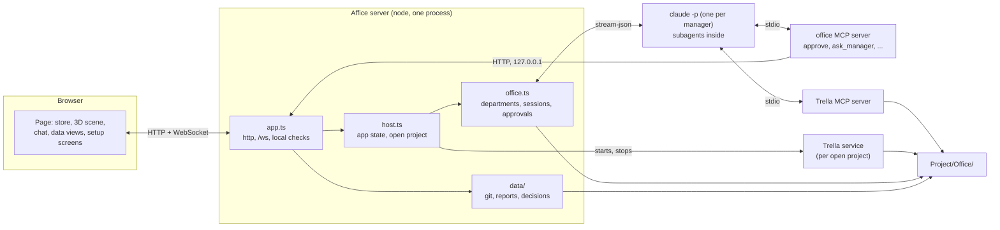

# Architecture

How Affice is built, as it is now. For what it does and how to use it, read the [README](../README.md). The wire contract between the server and the page is [`shared/types.ts`](../shared/types.ts), and an outline of it is in [section 11](#11-the-wire-contract-in-outline).

## 1. The shape of it

Affice is one Node process and one browser page.

- The **server** (`server/`) serves the built page, a small JSON API and a WebSocket on `127.0.0.1` (default port 4747). It holds the app state (Claude Code, the open project, the recent projects) and the office of the open project.
- Each department's **manager** is a separate `claude -p` process that the server starts and drives over stdin and stdout. Subagents run inside that process.
- **Trella**, the task board, runs as its own local service that the server starts for the open project.
- The **page** (`client/`) is plain TypeScript and the DOM, with a three.js scene. It keeps a reducer-style store, fed by the WebSocket, and sends commands back.



## 2. The launcher and the build

`bin/affice.js` is plain JavaScript with no dependencies, so it can explain itself on a Node that is too old. It parses the command (`start`, `doctor`, `init`, `--version`, `--help`), sets the environment (`AFFICE_PORT`, `AFFICE_PROJECT`, `AFFICE_OPEN_BROWSER`) and imports the built files.

`npm run build` produces `dist/`:

| Output | From |
| --- | --- |
| `dist/server.js` | `server/index.ts`: starts the server on import and reads its settings from the environment |
| `dist/cli.js` | `server/cli.ts`: the `doctor` and `init` commands |
| `dist/approvals-mcp.js`, `dist/run-script.mjs` | the office MCP server and the small shim that starts it |
| `dist/fixtures/office.json` | the seed for a new office's `affice.json` |
| `dist/client/` | the page, built by Vite |
| `dist/trella/` | Trella's CLI, server, core and MCP bundled into one file, next to its built web UI |

The server is bundled with esbuild (`scripts/build-server.mjs`) as ESM for Node 22, with `ws` left external. A clone and the installed package run the same code: `server/runtime.ts` finds the package root by walking up to the `package.json` named `affice`, and `trellaCli()` finds the vendored Trella in a clone and `dist/trella` in the package. The package contains `bin/`, `dist/`, `README.md`, `LICENSE`, `INSTALL.md` and `llms.txt`, and its only runtime dependency is `ws`. `dist/trella/` carries Trella's `LICENSE` and `FONT-LICENSES.txt`, the copyright notices and the SIL Open Font License text of the three typefaces its board ships (collected by `scripts/build-server.mjs`, which fails when a font file has no entry).

## 3. The server

`server/index.ts` is the entry. It starts the server, prints the address, opens the browser when asked, and on SIGINT or SIGTERM stops the manager sessions and Trella before it exits. A second `affice` on a port where Affice already answers (an unauthenticated `GET /api/app` gets Affice's own 401 sentence) says so and opens it.

| File | What it does |
| --- | --- |
| `server/app.ts` | `startServer`: http on `127.0.0.1`, the WebSocket at `/ws`, the routes, the built page, the local-only checks. Checks the port before it starts anything, so a taken port leaves nothing behind (`PortInUseError`). |
| `server/host.ts` | `AppHost`: the app state and the open project (section 4) |
| `server/office.ts` | `Office`: the commands, one session per department, the live snapshot, chat persistence, the office tools for the managers and their routes |
| `server/office-store.ts` | `OfficeStore`: `Office/affice.json` and the chat history; validation of the form and of the file on load (repair), id slugs, room slots; the general manager always exists |
| `server/router.ts` | `HttpRouter`: `:param` patterns, JSON answers, `RouteError` statuses, raw file answers, and the gate every route passes (page, agent or ticket access) |
| `server/auth.ts` | the secrets of the control channel: the page token, the per-department agent tokens, the report tickets, `checkPage`, `checkAgent` |
| `server/security.ts` | the exact Host and Origin policy, `Sec-Fetch-Site`, the Content-Security-Policy and the other headers of every answer |
| `server/coalesce.ts` | `RefreshGate`: a refresh that starts a process (git, `claude`) is shared while it runs and not repeated within a few seconds |
| `server/static.ts` | serves `dist/client`: hashed assets immutable, `index.html` never cached and carrying the page token, unknown paths without an extension fall back to `index.html`, no traversal, GET and HEAD only |
| `server/approvals.ts` | the approval requests the office MCP server posts, and their answers |
| `server/claude/driver.ts` | `ManagerSession`, the `claude` command line, the child environment, `SessionMapper` (stream-json to events), `CliManagerSession` |
| `server/claude/setup.ts` | finding `claude`, its version, whether it is signed in, and starting Claude Code's own sign-in |
| `server/claude/approvals-mcp.ts` | the stdio MCP server named `office` |
| `server/project/index.ts` | the Office folder, the recent projects, Claude Code's projects, the folder browser |
| `server/project/safe-fs.ts` | the only way Affice writes into a project: real folders only, `O_EXCL` creation, atomic replacement, appends that never follow a link, private modes (section 15) |
| `server/env.ts` | `minimalEnv()`, the allow listed environment of the helper programs (section 15) |
| `server/open-browser.ts` | opens the page in the user's browser, with the minimal environment |
| `server/protocol/index.ts` | `PROTOCOL.md`, the manager prompts and the MCP servers of a manager |
| `server/trella-service.ts`, `server/trella-cli.ts` | Trella's service lifecycle, and creating a department's board through Trella's CLI |
| `server/data/` | the data views |
| `server/doctor.ts`, `server/doctor-claude.ts`, `server/cli.ts` | `affice doctor` and `affice init` |

### The control channel

Who may call the server is decided in three layers (`server/app.ts`, `server/security.ts`, `server/auth.ts`).

1. **Where from.** The `Host` header must be this server's own (`localhost:<port>` or `127.0.0.1:<port>`), a browser `Origin` must be exactly this server's origin (scheme, host and port: another local port is refused), and `Sec-Fetch-Site: cross-site` or `same-site` is refused (another port of `localhost` is same-site). The one extra origin is `AFFICE_DEV_ORIGIN`, for the Vite page in development (`npm run server` and `start.sh` set it to `http://localhost:5190`). A request without an `Origin` (the MCP server, scripts) passes this layer and then needs a token.
2. **A token.** Two secrets are made when the process starts (32 random bytes as hex, compared in constant time, never logged). The **page token** goes to the page only: the server puts it into `index.html` as `<meta name="affice-token">`, and `GET /api/session` returns it to a same-origin request (in development, where Vite serves the page). The page sends it as the `x-affice-token` header on every `/api` request and as a WebSocket subprotocol (`affice`, `affice.<token>`; the answer names `affice`, so the token is not sent back, and it is never in a URL). Every page route and every socket command needs it. The **agent token** is per department, an HMAC of the department id under the process secret. The approvals MCP server of a manager gets it as `AFFICE_AGENT_TOKEN` and sends it with the department it was started for (`x-affice-department`). It opens only the agent routes (the approval round trip and the office tools) and the office takes the caller from it: a `from` or `department` in a body is not read, one manager cannot speak for another, and a manager can only wait for or cancel its own cards. It cannot answer an approval, switch bypass, chat, open a project or create a department: those are socket commands and need the page token. The page token never enters a child environment.
3. **A ticket, for a link.** A report opens in a new tab, and a link cannot send a header. The page asks `GET /api/data/:department/report-ticket?path=` (with its token) for a ticket that opens that one file for one minute (`&ticket=` on the report route).

The socket upgrade follows the same layers and accepts only the path `/ws`, frames of at most 1 MB and a client that offers the page token. A page on another site or another local port cannot drive a manager, DNS rebinding does not work, and neither does framing the page. Every answer carries `Content-Security-Policy` (`default-src 'self'`, no inline script or style, the socket on the same origin, `frame-src` for the Trella service on a local port, `frame-ancestors 'none'`), `X-Frame-Options: DENY`, `X-Content-Type-Options: nosniff`, `Referrer-Policy: no-referrer` and `Cross-Origin-Opener-Policy: same-origin`.

What the tokens do not do: the page token is in the page, and a plain `GET /` from a local program that sends no browser headers receives it, so the token keeps web pages and other localhost ports out, not local processes (another user of the machine, or a manager that may run one shell command). The bypass confirmation is asked by the page and is not enforced by the server. The agent tokens are in the `--mcp-config` argument of each `claude` process, so a local user who can list processes can read them. [SECURITY.md](../SECURITY.md) lists these as known limitations of the beta.

## 4. The host and the seams

`AppHost` starts with no project. At start it checks Claude Code and opens `AFFICE_PROJECT` if set. Every WebSocket connection gets `app.state` first, then `office.state` (with no departments while no project is open); both are sent again whenever they change.

**Opening a project** (`project.open {path}`) closes the open one first, then runs, in order:

1. `ensureOffice(path)` (`server/project/index.ts`) creates what is missing in `<project>/Office/` and returns the `OfficeLayout`, the absolute paths of everything.
2. `writeProtocol(layout)` (`server/protocol/index.ts`) writes `PROTOCOL.md` if it is not there.
3. `startTrella(layout)` (`server/trella-service.ts`) returns `{url}` or `{problem}`. A problem is shown as an error after the office opens, and departments are then created without a board.
4. `recordRecent(summary)` adds it to `~/.affice/projects.json`. A failure here is only logged.
5. An `OfficeStore` on `Office/affice.json` and `Office/chat/`, the `Office`, and one session per department. Sessions are not started: they start on `session.start` or on the first message.

A failure in steps 1 to 3 or in building the office leaves no project open and answers an `error` event with the sentence. Closing a project (and shutting down) disposes the office, so every session stops, then stops Trella, then sends `app.state` and an empty `office.state`.

While no project is open, every office command answers an `error` and every office route (`/api/office*`, `/api/approvals*`, `/api/data/*`) answers 409 with `No project is open. Choose a project first.`

The host calls those four modules by name through a `Seams` object, with the real modules as defaults, so the tests of the host (`server/host.test.ts`) pass fakes. Each module also registers its own routes through a small `HostHandle` (the app state, the layout, refreshing Claude Code, opening and closing a project).

## 5. The Office folder

```text
<project>/Office/
  affice.json      OfficeConfig: version, company (the project's folder name by default),
                   trellaUrl, and the departments
  PROTOCOL.md      the work protocol; written once, never overwritten
  .agentboard/     Trella's workspace, created by `trella init` with this folder as its cwd
  reports/         what agents write
  chat/            <department>.jsonl, one ChatMessage per line (the last 200 go to a new connection)
  .gitignore       chat/
```

`ensureOffice` creates only what is missing and never rewrites what exists. All of it goes through `server/project/safe-fs.ts`: `Office/`, `chat/` and `reports/` must be real folders directly inside their parent (a symbolic link, even one that points inside the project, is refused with a sentence that names it), files are created with `O_EXCL`, replaced through a temporary file and a rename, and chat lines are appended with `O_NOFOLLOW` to a regular file. `affice.json` and the chat files are made `0600` and the chat folder and `~/.affice` `0700`; `Office/` and `reports/` keep the default modes because the user may share them. A new `affice.json` holds the lobby's general manager and no other department, working in the project folder. A removed department's chat file is renamed, so a new department with the same id starts clean.

A department (`Department` in `shared/types.ts`) has an `id` (a slug, unique), `name`, `color`, `responsibility` (the user's text, which becomes the manager's instructions), `cwd`, `model`, `permission`, `repos`, `reportDirs` (relative paths start at the Office folder; a new department with none gets `reports`, the folder the protocol tells agents to write to), `knowledgeDirs`, `trellaBoardId`, `sessionId` (for resume), `slot` (the room's place in the building) and `kind`. `kind: 'lobby'` marks the general manager, id `general`, which has no room, cannot be removed, and defaults to the Read only policy. The store validates every field of a form, and validates the file again when it loads, because `affice.json` is committed with the project and can be edited by a person, a git clone or a manager: an unknown field or a department with a bad id is dropped or skipped, a bad model, color, permission, working folder, session id, board id, repo or Trella address is replaced by a safe default, and report folders, knowledge folders and repo paths of `/` or of the home folder are dropped (`shared/folders.ts`, also used by the form). When anything was lost the original is kept as `affice.json.corrupt-<time>`, the repaired file is saved once, and the host shows one sentence about it. A file that is not an office at all is kept the same way and a new office is made. A clean file is never rewritten.

Recent projects are kept in `~/.affice/projects.json` (at most 12, newest first, folders that no longer exist dropped). The picker also lists Claude Code's own projects, read only: the keys of `projects` in `~/.claude.json`, existing folders only, without the home folder itself, the root of the disk, worktree paths or the Claude desktop app's scratch workspaces (anything under its own data folder, `isClaudeWorkspace` in `server/project/index.ts`), ranked by the newest transcript under `~/.claude/projects/`. Nothing there is ever written.

## 6. Manager sessions

One `CliManagerSession` per department runs:

```text
claude -p --input-format stream-json --output-format stream-json --verbose
  --include-partial-messages --model <model> --name "<Department> manager"
  --append-system-prompt <prompt>  [--add-dir <knowledge folder> ...]
  [--forward-subagent-text]  [--resume <sessionId>]  <permission flags>  --mcp-config <servers>
```

with the department's `cwd` as the working directory. `--forward-subagent-text` is added when the installed `claude` is 2.1.211 or newer. User messages go to stdin as stream-json lines.

**Permission policies.**

| Policy | Flags |
| --- | --- |
| `ask` | `--permission-mode default`, `--allowedTools` with subagents (`Agent`, `Task`), `TodoWrite`, Trella's tools (`mcp__trella__*`), the three office tools and one `Read(//<folder>/**)` rule for each of the project, the Office folder and the department's knowledge folders (also for the real path of a folder that is a link), `--settings` with `ask` rules for `WebFetch` and `WebSearch`, `--permission-prompt-tool mcp__office__approve` |
| `accept-edits` | the same with `--permission-mode acceptEdits` |
| `read-only` | `--permission-mode dontAsk` and an allowed list with subagents, Trella's tools, the office tools and the same `Read` rules (no todo list), `--disallowedTools WebFetch,WebSearch` |
| bypass (a per session switch) | `--permission-mode bypassPermissions`, no prompt tool, no allowed list and no rules; the MCP servers stay |

No list holds a bare `Read`, `Grep`, `Glob`, `WebFetch` or `WebSearch`: reads are silent only inside the project and the knowledge folders (Grep and Glob follow the Read rules), and the web tools always go to a card (or are refused in `read-only`). A folder whose path cannot be written as a rule (a comma, a control character) gets no rule, so reads there ask. Every flag and its value are separate argv entries, no shell is involved, a session id that is not a plain id is left out (a new conversation starts), and a model that is not a model id stops the start.

**The environment** of the child is the server's own without any `CLAUDE_*` (except `CLAUDE_CONFIG_DIR`), `ANTHROPIC_*` or `MCP_*` variable, plus `TRELLA_PROJECT` (the office's Trella workspace). So the user's Claude Code sign-in is what a session uses, and nothing in the shell or in a Claude Code session that started Affice changes that. Claude Code's own settings files still apply. Other variables (`GITHUB_TOKEN`, `AWS_*`, `SSH_AUTH_SOCK`) do reach a manager, because a shell command the user allows may need them; the helper programs (git, Trella, the browser opener) get the minimal environment instead (section 15).

**Event mapping** (`SessionMapper`, which holds no process and is tested against a recorded session):

- `system/init` gives the session id and model. It arrives at every turn, so it produces a `session.state` only when one of them changes.
- Text deltas become `chat.delta` on one message per turn, closed by `chat.done`. An assistant `tool_use` becomes `tool.started` (with a one line summary) and its result `tool.finished`.
- `system/task_started` for a `local_agent` becomes an `agent.upsert` with status `arriving` (the subagent's avatar); messages with a matching `parent_tool_use_id` update its current tool and last text; `system/task_notification` sets `done` or `failed`; the agent is removed two minutes later.
- `result` becomes `turn.result` (cost of that turn, number of turns, duration) and the manager goes idle.
- The manager is `thinking` from the first assistant event of a turn until its first tool, and `working` while a tool or a subagent runs. Its presence exists as long as the session is on.

**Lifecycle.** A session is `off`, `starting`, `ready`, `busy`, `waiting` (for an approval) or `error` (with the last stderr line). Interrupt sends the stream-json `control_request` with subtype `interrupt`, which ends the turn and keeps the session. Stop interrupts, closes stdin, sends SIGTERM after a grace period and SIGKILL five seconds later. A `--resume` that fails before `system/init` clears the stored session id, so the next start is fresh. The server survives any process failure.

**Bypass.** `session.bypass {on}` restarts the process with `--resume <sessionId>` and either the bypass flags or the department's own policy, so the conversation continues. `SessionState.bypass` is true only for a run that started in bypass; every other start, a stop and a crash turn it off, and it is never written to `affice.json`. Turning it on while a turn runs is an error; turning it off is accepted at any time.

The driver is the one place that knows the CLI. Its interface, `ManagerSession`, is small (`start`, `send`, `interrupt`, `stop`, `setBypass`), so another implementation could replace it without touching the rest.

## 7. Approvals

In `ask` and `accept-edits`, Claude Code calls the tool `mcp__office__approve` with `{tool_name, input, tool_use_id}` before anything that needs permission. The office MCP server posts it to the office server (`POST /api/approvals`) and long-polls (`GET /api/approvals/:id/wait`, 25 seconds a round) for the answer. The request carries the agent token of its department (section 3), and the card belongs to that department: a manager can wait for and cancel only its own cards. `describeRequest` (`server/claude/approval-card.ts`) turns the call into the card the page shows: a one line summary, the folder, the file, and one labelled block for each part of the call (the whole command, the old and the new text of an edit, the content of a write, a URL, a query, the other fields), each capped at 8,192 characters with the number of characters cut, and with control, zero width and bidirectional characters written out as visible escapes. The office sends it as a `permission.requested` event, the page shows the card, and `permission.answer` resolves it. The tool answers Claude Code with `{"behavior":"allow","updatedInput":<input>}` or `{"behavior":"deny","message":...}`. If Claude Code cancels the call (an interrupt), the server posts the cancel and the card closes. The MCP server's tool timeout is set to 24 hours, so an approval can wait for as long as it takes. Switching bypass on or off, a stop and an exit close the session's open cards.

## 8. The protocol and the MCP servers

`server/protocol/index.ts` owns how managers behave.

- **`PROTOCOL.md`** is a generic template: the office and its roles, the card protocol (claim, comment, Review, the key in the branch, the commit trailer and the subagent description), reports, decisions, working in the project, collaboration, honesty. It is written once with the `wx` flag, so an existing file, even an emptied one, is never touched.
- **`managerPrompt`** builds the appended system prompt: who the manager is and for which project and office, its responsibility, its board, its Trella identity, the folders it reads, the reply rules, and then the text of `PROTOCOL.md` as it is now (the template if the file is missing or empty). The general manager's prompt differs: it answers general questions, does not write to its knowledge folders, and asks department managers instead of doing their work.
- **`managerMcpServers`** gives every manager two servers through `--mcp-config`, merged with the user's own (no strict flag):
  - `trella`: the Trella CLI run as `trella mcp`, with `TRELLA_PROJECT` set to the office's workspace and `TRELLA_ACTOR` to the manager's own identity (`agent:<department id>-manager`), so every write on the board is attributed. Left out, with one log line, when Trella is missing or not built.
  - `office`: `approve` and three tools for the other departments, which need no card as tools in any policy: `list_departments`, `office_status` and `ask_manager`. Its `env` carries the office address, the department and the department's agent token (`AFFICE_AGENT_TOKEN`), which is part of the `--mcp-config` argument.
- **Knowledge folders.** `knowledgeDirs` lists extra folders a manager reads, absolute or relative to the project; each existing one becomes an `--add-dir`. For the general manager, when unset, the default is the Office folder and the project's `README.md`.

**`ask_manager`.** The call is `POST /api/office/ask {department, message}` with the caller's agent token; the asker is the department of the token, never a field of the body. It is answered when the target's turn ends. The message appears in the target's chat as a `colleague` message from the asker, the target's session is started with resume if it is off, and the message is written with `priority: "later"` so it gets a turn of its own. After 10 minutes the call returns what it has with a note that the manager is still working. The guard: the caller must be a known manager, not the target itself; a target running in bypass is refused; a target that is itself waiting for an answer is refused (which rules out every cycle); and a chain may be at most two managers deep. A target that accepts edits is asked through the user: the office creates an approval card in the asking manager's chat with the whole message (at most 8,192 characters, longer is refused), and nothing reaches the target before the user allows it; a denial, or the end of the asking session while the card waits, gives the asker a refusal. Targets in `ask` and `read-only` take the question without a card, because what they do still goes through their own rules. An ask is released when the answer comes, on timeout, or when the asking session ends.

## 9. Trella

The office needs a board, so Affice manages Trella's lifecycle (`server/trella-service.ts`). `startTrella(layout)`:

1. runs `trella init --name <project> --port <free port>` once, when `Office/.agentboard/config.json` is missing, with the Office folder as the working directory;
2. runs `trella start --port <n> --host 127.0.0.1 --no-open` there, on the first free port from `AFFICE_TRELLA_PORT` (default 4174), with the minimal environment (section 15);
3. waits up to 10 seconds for a live process in `.agentboard/service.json` and `GET /api/health` answering `{ok:true}`;
4. answers with `http://localhost:<port>` (not `127.0.0.1`: the board is embedded in the page, and both must be the same site).

Before the start, Affice refuses an `.agentboard` that is a symbolic link and a `config.json` whose data, inbox or outbox folder is outside the Office folder, and the host in `config.json` is ignored (the flag wins). After the start it checks where Trella really listens (`service.json`, and a health request to the port on each of the machine's non-loopback addresses); a service that answers there is stopped, or not used when Affice did not start it. A live service that is already there (an earlier Affice that crashed, or one the user started) is reused and never stopped by Affice, and `service.json` is trusted for it (a known limitation, see [SECURITY.md](../SECURITY.md)). A stale `service.json` is ignored. `stopTrella` ends the child it started. A new department gets its Trella project and board through the CLI (`server/trella-cli.ts`), run in the Office folder.

Trella is vendored under `vendor/trella`, unmodified, as npm workspaces. The Kanban view is Trella's own web UI in an iframe at `<trellaUrl>/?board=<boardId>`.

## 10. The data views

Read only, and nothing is stored. `server/data/` reads git, the report folders and Trella's JSON, and `client/ui/views/` draws them.

- **Branches** (`git.ts`): for each repository of the department (a relative path starts at the project folder, the parent of Office, so `.` is the project; a folder inside a repository is read as that repository, found upward, unless that repository is the home folder or the root of the disk), every local branch with ahead and behind against the base, whether it is merged (by ancestry or by patch with `git cherry`, counting `main`, `master` and `deploy` as trunks), last commit, worktree, uncommitted file count and a state: `base`, `in-flight`, `leftover` (merged), or `stale` (not merged, last commit 7 days old or more, no uncommitted changes). Every call is `git --no-optional-locks --no-pager -c core.fsmonitor=false -c core.hooksPath=/dev/null -c core.sshCommand=false -c protocol.ext.allow=never -C <repo> ...` with the clean, smudge and process filters the repository names blanked (found with a read-only `git config` query), `GIT_CONFIG_NOSYSTEM=1`, `GIT_TERMINAL_PROMPT=0` and the minimal environment, because a repository's own config can name programs that git would run. At most six calls run at a time, with a 20 second timeout, and never a fetch or a write; a status does not enter submodules, and a base branch that starts with a hyphen counts as missing. Results are cached by commit (never stale) and as a 10 second snapshot per repository. The page draws it as a metro map in hand written SVG.
- **Reports** (`reports.ts`): `.md` and `.html` files in the department's report folders (not recursive, no hidden files), newest first, with the date and card key from the file name and the title from the first heading. A single report is served raw by `GET /api/data/:department/report?path=<absolute>` only when it resolves, symlinks included, to a file inside one of those folders (403 otherwise, 413 above 5 MB). HTML goes out with `Content-Security-Policy: sandbox; default-src 'none'; style-src 'unsafe-inline'; img-src data:` (an opaque origin, no scripts, no network, no navigation) and `Content-Disposition: inline`, so a report cannot reach the office API or the socket, and loads nothing from the internet (a link inside it still works when the user clicks it). The listing applies the same real-path test as the route, so a link that leaves the folder is not listed and its target is never read for a title. The page asks for a one minute ticket to open a report in a new tab (section 3).
- **Decisions** (`trella.ts`): reads `.agentboard/projects/**` directly, and lists open cards labelled `decision` on every board of the project's workspace, the department's own board first. No board is special, and the general manager, which has no board of its own, sees them all.
- **Kanban**: the board in an iframe, with a probe first and a message when Trella is not running.

## 11. The wire contract in outline

Everything the page and the server exchange is declared in `shared/types.ts`.

**HTTP** (every `/api` route needs the page token in `x-affice-token`, except `GET /api/session` and the agent routes marked below, which need an agent token; office routes answer 409 while no project is open):

| Route | Answer |
| --- | --- |
| `GET /api/session` | `{token}`, the page token, to a same-origin request only |
| `GET /api/app` | `AppState`: `claude` (a `ClaudeStatus`), the open `project`, the `recent` projects |
| `GET /api/claude[?refresh=1]` | the `ClaudeStatus`, optionally checked again first |
| `GET /api/projects` | `ProjectSummary[]`: recent, then Claude Code's |
| `GET /api/fs?path=<abs>[&hidden=1]` | `FolderListing`: folder names only |
| `GET /api/office` | the `OfficeSnapshot` |
| `GET /api/data/:department/branches[?refresh=1]`, `.../reports`, `.../decisions`, `.../report?path=` | the views above; a refresh that runs git is shared and at most once every 5 seconds per department |
| `GET /api/data/:department/report-ticket?path=` | `{ticket}`: one minute, that file only, for `.../report?path=&ticket=` |
| `POST /api/approvals`, `GET /api/approvals/:id/wait`, `POST /api/approvals/:id/cancel` | the approval round trip of the office MCP server (agent token) |
| `GET /api/office/departments`, `GET /api/office/status`, `POST /api/office/ask` | the office tools of the managers (agent token; the caller of `ask` is the department of the token) |

`ClaudeStatus` never holds account details: only whether Claude Code is installed, its path and version, whether the version is too old, whether it is signed in and by which method, a sign-in in progress and its link, and the last problem as a sentence.

**WebSocket at `/ws`.** Every frame is one JSON object. On every connection the server sends `app.state`, then `office.state`.

| Server to page (`ServerEvent`) | Meaning |
| --- | --- |
| `app.state`, `office.state` | the app, and the whole office snapshot (config, sessions, agents, the last 200 messages per department, open approvals) |
| `department.created`, `department.updated`, `department.removed` | a department changed |
| `session.state` | one session's status, bypass flag, session id, model, error |
| `chat.message`, `chat.delta`, `chat.done` | chat: a whole message, text appended to a message, a message closed |
| `agent.upsert`, `agent.removed` | the manager and subagent presences that drive the avatars and bubbles |
| `tool.started`, `tool.finished` | a tool call of an agent, with a one line summary |
| `permission.requested`, `permission.resolved` | an approval card opens, or closes |
| `turn.result` | the cost, turns and duration of a finished turn |
| `error` | a sentence for the user, for a department or the app |

| Page to server (`ClientCommand`) | Meaning |
| --- | --- |
| `claude.refresh`, `claude.login`, `claude.cancelLogin` | check Claude Code again; start or cancel Claude Code's own sign-in |
| `project.open {path}`, `project.close` | open a project (creating its Office folder), or close it |
| `chat.send`, `session.start`, `session.stop`, `session.interrupt`, `session.bypass` | talk to a manager and control its session |
| `department.create`, `department.update`, `department.remove` | manage departments |
| `permission.answer {id, allow}` | answer an approval card |

A chat message has a role (`manager`, `system`, `colleague` for a message from another manager with `fromName`, or `user` for the person typing; history files written before that role was renamed say `founder`, and the server reads them as `user`), its text, and whether it is still streaming. Presences (`AgentPresence`) carry an id (`manager:<department>` or a subagent's task id), a title, a card key parsed from the title, a model, a status (`idle`, `thinking`, `working`, `waiting`, `arriving`, `done`, `failed`), the current tool and the last text.

## 12. The page

- **State.** `client/state/store.ts` is a reducer over `ServerEvent`s. The server uses the same reducer to build the snapshot it sends to a new connection, so a fresh page holds exactly what a page that saw every event would. `client/state/ui.ts` holds UI only state (the tab, the form, drafts). `client/ui/socket.ts` connects to `/ws` with backoff and reports `connecting`, `live` or `offline`; `client/ui/session.ts` holds the page token (the meta tag, or `/api/session`), adds it to every `/api` request and asks again after a refusal (a restart).
- **Setup gate** (`client/ui/setup/`): while Claude Code is not ready or no project is open, a full page screen covers the office and asks for what is missing: the Claude Code screen (install, sign in, check again), then the project picker. The office stays mounted behind it.
- **Shell** (`client/ui/`): the top bar, the lobby panel (project name and menu, the departments), the room panel with its tabs, the chat (streaming text, interrupt, the bypass switch, approval cards), the roster of agents, the department form with templates, toasts. Text from the server only ever goes in through `textContent`.
- **Scene** (`client/scene/`): procedural three.js geometry only (boxes, cylinders, spheres, cones, capsules; no model files or textures), an orthographic isometric camera, one room per department along a corridor, a lobby with the project's name and a reception desk for the general manager, avatars that arrive, sit, type, wait with a raised hand, wave and leave, and speech bubbles as HTML. It renders on demand and stops when nothing moves. The budget is 150 draw calls and 80 thousand triangles with six rooms and twenty avatars, a device pixel ratio capped at 1.5, one directional light with a single 1024 shadow map, and instancing for desks, chairs, monitors and plants; `client/scene/budget.html` (served by Vite in development) prints the real numbers. If the scene cannot start, an inert one takes its place and the chat and panels still work.
- **Mock.** With `?mock=1` the page replays `fixtures/events.json` instead of opening a socket and never shows the setup gate.

## 13. Tests

`npm test` runs the built-in Node test runner through `tsx` over `server/**`, `client/**` and `shared/**`. The session mapper is tested against a recorded real session (`fixtures/recorded-session.jsonl`) and the command line per policy; Claude Code is faked with scripts in temporary folders; Trella and the launcher are tested for real on spare ports and need `npm run build`. No test starts a real Claude session or touches the real home folder. See [CONTRIBUTING.md](../CONTRIBUTING.md).

## 14. Decisions worth knowing

- **The CLI, not the Agent SDK.** Affice drives the user's own, unmodified `claude`, signed in the way Claude Code signs in, and never handles a credential. The driver has a small interface so that could change.
- **Everything of the office lives in the project's `Office/` folder,** so it can be committed, moved or deleted with the project, and each project has its own office.
- **The protocol is text,** appended to every manager's prompt and editable by the user, not code.
- **`localhost` for the page and the board.** They must be the same site, or the board renders blank in the iframe.

## 15. The security model

[SECURITY.md](../SECURITY.md) is the full account, with the known limitations of the beta and how to report a problem. In short, and as the code does it today:

- **Local only.** The server binds `127.0.0.1`. The `Host` must be `localhost:<port>` or `127.0.0.1:<port>`, a browser `Origin` must be exactly this server's origin (scheme, host and port), and `Sec-Fetch-Site: cross-site` or `same-site` is refused, on every `/api` route and on the socket (`server/security.ts`).
- **Tokens.** A page token per start, held by the page (in the served `index.html`, and from `/api/session` for a same-origin request); a token per department for the agent routes only; a one minute ticket for a report link (`server/auth.ts`, section 3). The page token is in the served page, so a local process that can read the page over loopback can read the token: the tokens keep web pages and other localhost ports out, not local processes.
- **Headers.** Every answer carries the CSP (no inline script or style), `X-Frame-Options: DENY`, `nosniff`, no referrer and `Cross-Origin-Opener-Policy: same-origin`. Text from outside goes into the page only as `textContent`.
- **The report viewer.** Only `.md` and `.html` inside the department's report folders, by real path; HTML in a sandbox with no network (section 10).
- **Files.** `server/project/safe-fs.ts` is the only way Affice writes into a project: no symbolic links, `O_EXCL`, atomic replacement, `realpath` containment. `affice.json` is validated on load and repaired, the original kept as `.corrupt-<time>`. `affice.json`, the chat files and `~/.affice/projects.json` are `0600`, the chat folder and `~/.affice` `0700`. A report folder, knowledge folder or repo of `/` or the home folder is refused (`shared/folders.ts`, in the store and in the form). The folder browser lists folder names only.
- **Helper programs.** git runs hardened and read only (section 10). Trella listens on `127.0.0.1` only and its config is checked (section 9). Trella, the Trella CLI, git, `npm prefix -g` and the browser opener get `minimalEnv()` (`server/env.ts`), an allow list: `PATH`, `HOME`, `USER`, `LOGNAME`, the locale, `TZ`, the temporary folders, `TERM`, `XDG_*_HOME`, the Windows system names, and for the browser opener the desktop session variables. The `claude` processes (the version and sign-in checks, and the managers) keep the user's environment minus `CLAUDE_*` (except `CLAUDE_CONFIG_DIR`), `ANTHROPIC_*` and `MCP_*`, because Claude Code needs the user's login and settings. Nothing is started through a shell.
- **What runs without asking.** Reads inside the project and the knowledge folders, subagents, the todo list (not in `read-only`), Trella's board tools and the office tools. **What always asks:** writes and edits (except edits in `accept-edits`), shell commands, `WebFetch` and `WebSearch`, reads outside the project and the knowledge folders, and a question to a manager that accepts edits. `read-only` has no way to ask, so it refuses all of those. **Bypass** turns the checks off for one session, is asked for by the page, and is never saved.
- **The headless trust note.** Managers run `claude -p`, which skips the folder trust dialog, so a project's hooks and its `.mcp.json` servers run when a manager starts. A project is trusted code.
- **Out of scope.** Claude Code itself, Trella itself, what a manager does after the user allows a tool or switches bypass on, exposing Affice to a network on purpose, and the known limitations listed in SECURITY.md.
